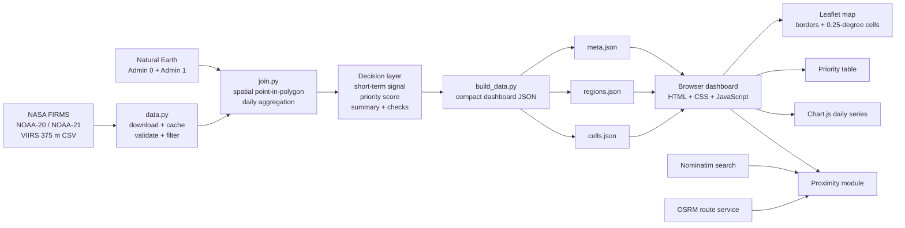

# EmberWatch

**EmberWatch** is a global fire-detection decision-support dashboard built from NASA FIRMS VIIRS observations. It helps users screen country-, state-, and grid-level activity across a 7-day window.

This project is an EVS course application focused on SDG 15, SDG 13, and SDG 11. EmberWatch is a screening aid, not a confirmed-fire map.

> EmberWatch reports **fire detections**, never causes or unique fires. The short-term signal, priority score, and suggested checks are screening tools, not validated risk assessments or official response instructions.

## Feature highlights

- **Interactive global map** - 0.25-degree grid cells, country and state borders, automatic zoom, and FRP-based colour and size encoding
- **Region explorer** - alphabetically sorted country and state dropdowns
- **Priority ranking** - 0-100 relative score with High, Medium, and Low tiers, sortable by priority or Total FRP
- **Short-term signals** - Rising, Stable, Falling, or Insufficient data based on complete UTC days
- **Daily chart** - detection count and FRP over time with partial UTC days clearly marked
- **Regional summaries** - totals, rank, period, short-term signal, and suggested checks
- **Point-radius screening** - search or click a location and inspect detections within 10, 25, or 50 km
- **Route-corridor screening** - place waypoints, optionally snap to roads with OSRM, and inspect detections in a 10, 25, or 50 km corridor
- **Generated dashboard data** - the browser can run from committed JSON files without rebuilding the pipeline

## Architecture



## Project tour

### 1. Region mode

The default view starts at world scope. Choose a country, then optionally select a state or province. Every panel updates to the selected region:

- the map filters to matching grid cells and zooms to their extent;
- the table switches from worldwide countries to states within the chosen country;
- the chart shows the selected region's daily detection count and FRP;
- the summary shows totals, rank, short-term signal, period, and suggested checks.

### 2. Map

The map uses Leaflet and the browser canvas for performance. It draws only the grid cells that match the current region instead of creating one DOM marker per detection. Each circle represents a 0.25-degree grid cell (approximately 28 km); circle size represents detection count and colour represents total FRP.

Country boundaries come from generated GeoJSON. State boundaries are loaded on demand for the selected country.

### 3. Priority table

The table ranks countries worldwide or states within the selected country. It supports sorting by Priority score or Total FRP, and shows detections, FRP, short-term signal, rank, and tier.

The priority score is a relative percentile rank, not an absolute risk value. It blends total FRP, detection count, and short-term change. Insufficient-data regions are handled without the short-term term.

### 4. Daily chart

The Chart.js view plots detections and FRP on separate axes for the world or a selected region. Partial UTC days use hollow points and dashed segments so incomplete edge-of-window observations are not mistaken for complete days.

### 5. Proximity Check mode

**Point radius**

Search for a place or click the map, choose a 10, 25, or 50 km radius, and see matched grid cells, detection totals, total FRP, nearest-cell distance, and a clear-to-high activity label.

**Route corridor**

Place waypoints or search named locations. EmberWatch draws a corridor and can optionally snap the route to roads through OSRM. Results include per-segment detection and FRP totals.

Proximity calls use public Nominatim and OSRM services. Their availability is not guaranteed and is not required for region mode.

## Quick start

Python 3 is required.

```powershell
pip install -r requirements.txt
python -m http.server
```

Open <http://localhost:8000>. Do not open `index.html` directly: browser file-origin restrictions prevent the dashboard from fetching JSON.

The dashboard uses public Leaflet, Chart.js, Fontshare, Nominatim, and OSRM services. The committed JSON files allow region mode to run without rebuilding the data, subject to CDN availability.

## Refresh the data

Refreshing needs internet access. NASA FIRMS downloads can be slow.

```powershell
python build_data.py
python build_data.py --force
```

The default build reuses fresh cached CSV and joined-data files. `--force` downloads the FIRMS inputs again.

Rebuild and commit `data/*.json` in a coordinated change to avoid merge conflicts. FIRMS CSVs, Natural Earth boundaries, and the joined Parquet cache are local pipeline assets.

## Tests

```powershell
python test_data.py
python test_join.py
python test_decision.py
node test_proximity_math.js
```

Each Python test and the proximity-math test should finish with `PASS`.

## How the pipeline works

1. `data.py` downloads or reads the NOAA-20 and NOAA-21 FIRMS 7-day global CSV files.
2. Invalid coordinates and low-confidence detections are removed; nominal and high-confidence detections remain.
3. `join.py` performs a Natural Earth Admin 0 join, then an Admin 1 join. Detection points outside a polygon remain **Unassigned**.
4. Detection count and FRP are aggregated into country, state, and 0.25-degree grid views.
5. `data.py` calculates complete-day short-term signals and priority scores.
6. `build_data.py` writes strict JSON artifacts:
   - `data/meta.json` - data freshness, counts, thresholds, and limitations;
   - `data/regions.json` - countries and states with series and decision fields;
   - `data/cells.json` - compact grid rows with no raw point records.
7. `app.js` and `proximity.js` render the static dashboard and browser-side checks.

Raw detection points are not exported by the dashboard build.

## Scoring and terminology

The implementation uses these definitions:

- **Low-confidence filter** - low confidence is dropped; nominal and high confidence are kept.
- **Short-term signal** - mean daily detection count and FRP for the last 2 complete UTC days compared with the prior 5 complete UTC days.
- **Short-term percentage** - average percentage change across detection count and FRP.
- **Signal labels** - above +15% is Rising, below -15% is Falling, otherwise Stable.
- **Insufficient data** - fewer than 10 detections in the comparison window.
- **Priority score** - percentile ranks of FRP, detection count, and short-term change, weighted 0.5 / 0.2 / 0.3.
- **Priority tiers** - High at 75+, Medium at 40+, and Low below 40.

All tunable values live in `data.py`. The threshold, weights, and tier cutoffs are starting choices and are not validated risk measures.

## Project structure

```text
data.py              FIRMS loading and decision-support layer
join.py              Natural Earth spatial joins and aggregation
build_data.py        pipeline orchestrator and compact JSON writer
make_borders.py      simplified country/state border generation
index.html           dashboard markup and CDN dependencies
style.css            responsive dark-theme presentation
app.js               region mode, map, table, chart, and summary
proximity.js         point-radius and route-corridor screening
test_data.py         loader and decision-layer tests
test_join.py         spatial join and aggregation tests
test_decision.py     end-to-end build-data tests
test_proximity_math.js
                     proximity math tests
data/                generated JSON, borders, caches, and source assets
docs/                project plans and supporting documentation
HANDOFF.md           detailed pipeline handoff and known issues
```

## Limitations

- A fire detection does not prove that a confirmed fire exists. Agricultural burning, gas flares, industrial heat, and other sources can contribute.
- NOAA-20 and NOAA-21 pass times may overlap; detection counts are observations, not unique fires.
- Satellite passes are limited, cloud and smoke can hide activity, and a VIIRS pixel is approximately 375 m wide.
- The near-real-time source is not science-quality data.
- The 7-day window and 2-day recent comparison make short-term signals noisy.
- Partial first and last UTC days are excluded from the signal comparison.
- FRP values are approximate and may repeat across neighbouring pixels.
- UTC grouping may place late-evening local observations on the next date.
- Natural Earth boundaries may leave detections from coastlines, offshore areas, and borders Unassigned.
- The priority weights and thresholds are a starting choice, not a validated risk model.
- Point and corridor proximity verdicts use only the loaded 7-day grid and public route/geocoding responses.

## Data sources

- [NASA FIRMS](https://firms.modaps.eosdis.nasa.gov/) - VIIRS 375 m active fire detections from NOAA-20 and NOAA-21
- [Natural Earth](https://www.natural-earth-earth-vector.readthedocs.io/) - 10 m Admin 0 and Admin 1 boundaries
- [Leaflet](https://leafletjs.com/) - interactive map
- [Chart.js](https://www.chartjs.org/) - daily chart
- [Nominatim](https://nominatim.openstreetmap.org/) - place search
- [OSRM](https://project-osrm.org/) - optional road route snapping

## Working together

- Pull before starting work.
- Use a dedicated branch for new changes.
- Do not hand-edit generated `data/*.json` files.
- Coordinate generated-data commits to avoid large merge conflicts.
- Never join pandas string columns with `+`; pandas 3 and pyarrow-backed columns require numeric or explicit dtype handling.
